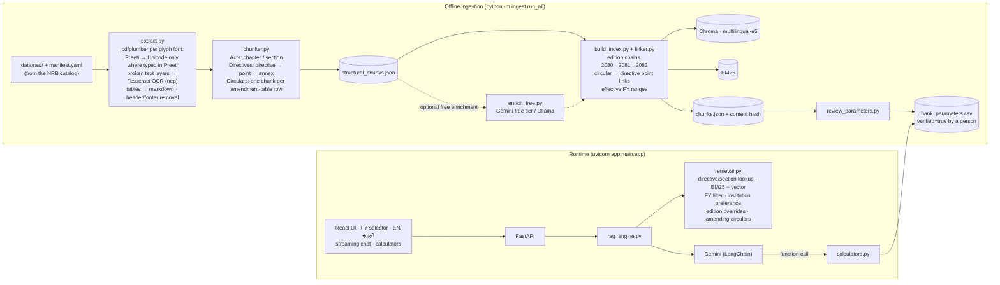

# Nepal Bank Sahayak (नेपाल बैंक सहायक)

A fiscal-year-aware RAG assistant that explains **Nepal Rastra Bank (NRB) rules** in plain language, in
English or Nepali: the banking Acts, the NRB **unified directives** (for class A/B/C banks, microfinance,
the infrastructure bank, payment service providers, cooperative banks), the **foreign-exchange unified
circular**, NRB **circulars and notices**, bylaws, guidelines and **monetary policy**. Every answer says which
fiscal year it applies to, which institution type a rule is for, and cites the directive/point, circular or Act section.

It is built on the same stack as the *Nepal Constitution Chatbot* and the *Nepal Tax Sahayak*
(FastAPI, LangChain + Gemini, Chroma + BM25, React 19 + Vite + Tailwind 4) and costs nothing to run.

---

## The corpus

`backend/data/catalog/nrb_core_catalog.json` lists **125 official NRB documents** (≈121 MB, ≈4,600 pages),
all downloaded from nrb.org.np:

| Folder (`backend/data/raw/`) | What | Files |
|---|---|---|
| `acts/` | BAFIA 2073 (Nepali + English), NRB Act 2058 (Nepali + English), Payment and Settlement Act, Banking Offence and Punishment Act, Money Laundering Prevention Act, Foreign Exchange (Regulation) Act, Negotiable Instruments Act, Debt Recovery Act, Consumer Protection Act, Privacy Act | 12 |
| `rules/` | NRB bylaws: inspection & supervision, merger & acquisition, prompt corrective action, resolution, remittance, FX licensing, foreign investment & loans, money changers, RTGS, credit information, hedging, … | 16 |
| `directives/` | Unified directives 2082 (A/B/C, microfinance, infrastructure bank, payment systems, cooperative banks), FX unified circular 2082, and the 2081 / 2080 editions (to explain what changed) | 9 |
| `circulars/<FY>/` | Circulars and notices of FY 2080/81 – 2083/84 that amend those directives (`bfr-` bank regulation, `psd-` payment systems, `fx-` foreign exchange) | 66 |
| `monetary_policy/<FY>/` | Monetary policy 2081/82 – 2083/84 with quarterly reviews | 10 |
| `policies/` | Digital lending, regulatory sandbox, cyber resilience, NepalQR, licensing policies, D-SIB framework, … | 12 |

The PDFs are already in `data/raw/`. Each catalog entry has its `source_url` on nrb.org.np if one has to be fetched again.

`data/raw/manifest.yaml` is generated from the catalog (`python -m ingest.generate_manifest`). For each document it
records the type, NRB title, language, fiscal year, **family** (which rulebook: `abc`, `mfi`, `nifra`, `psd`, `fx`,
`ncbl`, `general`), the **institutions** it applies to, the **edition year** of the directive it is or amends,
the circular number and the source URL — all inferred from NRB's titles, editable by hand.

## How it works



**Fiscal-year logic.** NRB reissues each unified directive as a new *edition* (2080, 2081, 2082) and amends it
during the year with numbered circulars. Mapped onto chunks:

* An edition is in force from its fiscal year until the fiscal year the next edition is issued (in that overlap
  year both exist and the newer one wins; the older point is shown as *superseded*).
* Each point of an edition is linked to the same point of the previous edition, so answers can say
  *"Under the 2081 directive it was X; the 2082 directive makes it Y"*.
* A circular applies from its fiscal year until the next edition consolidates it. The directive numbers it names
  ("इ.प्रा. निर्देशन नं. १४/०८२ को बुँदा नं. २") link it to exactly those points; when one of them is retrieved,
  the circular is added to the context as an **AMENDMENT** that takes precedence.
* Acts, bylaws and policies are always eligible; monetary policy applies to its own year.

**Institution types.** Rules differ for class A/B/C banks, microfinance, the infrastructure bank, payment
providers etc. The retriever prefers the rulebook the question is about ("microfinance", "wallet", "लघुवित्त"…)
and class A/B/C otherwise (`DEFAULT_FAMILY`); every source card shows which institutions it applies to.

**Text extraction details that matter for NRB PDFs**

* Most directives and circulars are typed in the legacy **Preeti** font with English words in Unicode fonts.
  Conversion happens per glyph run using the font name, so "ICAAP Guidelines" stays English while the Nepali
  around it is converted. Numbering fonts (Fontasy Himali, Bishall…) become Devanagari digits.
* The Nepali Acts published in 2025 have a **broken text layer** ("मिलाइएको" extracts as "ममलाइएको"); they are
  detected and OCR'd with Tesseract (`--psm 4`, which keeps hanging-indent section numbers with their text).
  Scanned notices are OCR'd too. OCR results are cached per page, so re-running is instant.

## Setup (Windows, PowerShell)

Requirements: Python 3.10+ (your `myenv` works), Node.js 18+, a free Gemini key from <https://aistudio.google.com>
(do not link billing). Tesseract with **Nepali** is only needed if you re-extract from scratch; the extracted
text cache in `data/processed/` is included.

```powershell
cd nepal-bank-sahayak\backend
..\..\nepal-tax-sahayak\backend\myenv\Scripts\Activate.ps1      # or: python -m venv myenv; myenv\Scripts\Activate.ps1
pip install -r requirements-dev.txt
copy .env.example .env                                         # set GOOGLE_API_KEY=...
python -m ingest.run_all                                       # extract (cached) → chunk → index → parameter candidates
python -m ingest.review_parameters --review                    # check the calculator figures (see below)
uvicorn app.main:app --port 8000
```

```powershell
cd ..\frontend
npm install
copy .env.example .env      # VITE_API_URL=http://localhost:8000
npm run dev                 # http://localhost:5173
```

The first index build downloads the embedding model `intfloat/multilingual-e5-base` (~1.1 GB) and embeds
≈7,300 chunks on the CPU (roughly 20–40 minutes, once). macOS/Linux: same commands with `source myenv/bin/activate`.

## Calculators (verified figures only)

| Calculator | What it does | Figures it needs |
|---|---|---|
| Loan-loss provision | Classifies each loan by months overdue (pass / watch list / substandard / doubtful / loss) and computes the minimum provision | provisioning % per category and the overdue period of each category, from the unified directive of the chosen institution type |
| Cash payment limit | Says whether one cash transaction reaches the legal limit above which it must go through a bank | the cash-transaction limit from the NRB notice |

No figure is written in the code. `python -m ingest.review_parameters` finds them in the indexed documents and
writes `data/processed/bank_parameters.csv` with the exact quote, file and the PDF page on which the quote appears
(the page number in the PDF viewer, not the printed page number), all `verified=false`. `text_source=ocr` marks a quote
read by OCR from a scanned page (it may contain OCR typos; compare the figure by eye). Overdue periods are stored as
`min_months`/`max_months`; their `value` is empty.
`--review` shows each row and asks you to confirm it against the PDF (or edit the CSV in Excel). The calculators
use only verified rows for the selected fiscal year (newest edition wins in overlap years) and refuse otherwise.
Re-running keeps your verifications as long as the figure and quote did not change. Results list the circulars
that amend the provision, and say that special cases (rescheduled loans, relief circulars) are not modelled.

## Free enrichment (optional)

The default build (`ENRICH_PROVIDER=none`) uses deterministic metadata plus a bilingual banking glossary
(`ingest/glossary.py`: "karja noksani" ↔ "कर्जा नोक्सानी व्यवस्था" ↔ "loan loss provision", "kalo suchi" ↔
"कालोसूची" ↔ "blacklist", …). For richer metadata, `ENRICH_PROVIDER=gemini` enriches chunks on the Gemini free
tier (≈7,300 chunks take several days of free daily quota; it stops cleanly and resumes), or `ollama` runs a
local model. Nothing in the project needs a paid key.

## Adding new circulars or a new edition

1. Download the PDF into `data/raw/circulars/<FY>/` (or `directives/`), e.g. `circulars/2083-84/bfr-circular-6-abc.pdf`.
2. Add an entry to `manifest.yaml` with the NRB title (family, institutions, edition and circular number are inferred
   from it), `doc_type`, `language` and `fiscal_year`. Or add the row to `data/catalog/nrb_core_catalog.json` and run
   `python -m ingest.generate_manifest`.
3. `python -m ingest.run_all` — only the new file is extracted; links and FY ranges are recomputed for the whole corpus.
4. Re-run `python -m ingest.review_parameters --review` if a new edition changed any figure.

## Tests

```powershell
cd backend
pytest                  # 95 tests: FY maths, directive/section detection, chunker (directives, amendment rows,
                        # lone OCR section numbers), Preeti + font-aware conversion, broken-text detection,
                        # edition/circular linking, old-vs-new edition selection, calculators, API + SSE,
                        # and the regression tests of tests/test_fixes.py
ruff check .
cd ..\frontend; npm run lint; npm run build
```

Tests use a small SAMPLE corpus in `backend/tests/fixtures/raw/` (clearly marked, not real NRB text), hashing
embeddings and a fake LLM, so they need no network and no keys.

## API

| Method | Path | Body / result |
|---|---|---|
| GET | `/health` | status, index loaded, LLM configured |
| GET | `/fiscal-years` | `{current, default, available[], calculator_years{loan_provision[], cash_limit[]}}` |
| POST | `/chat` | `{message, session_id, fiscal_year?, language?}` → `{answer, fiscal_year_used, fy_warning?, language, sources[], calculation?}` |
| POST | `/chat/stream` | same input; SSE events `meta`, `token`…, `done` or `error` |
| POST | `/calculate/loan-provision` | `{fiscal_year, family: abc\|mfi\|nifra, loans: [{amount, months_overdue \| category}]}` |
| POST | `/calculate/cash-limit` | `{fiscal_year, amount}` |
| GET | `/documents` | indexed documents with type, family, FY and chunk counts |

## Limitations

* **Not legal or financial advice.** Answers are only as good as the indexed documents; check the latest circulars.
* The corpus is a core set (current editions + about two years of circulars). Older circulars, FAQs and press
  releases on nrb.org.np are not included; add them the same way if you need them.
* OCR of the Nepali Acts is good but not perfect: a few section numbers are lost (those sections are cited by title)
  and some letters are misread (e.g. "बेङ्क" for "बैङ्क"). The English versions of BAFIA and the NRB Act are included.
* Circular-to-directive linking relies on the directive number written in the circular. Circulars that only describe
  a change in words are still retrieved by search, but are not attached to the point they change.
* Preeti conversion is rule-based; rare glyph combinations can come out wrong. Spot-check important answers in the PDF
  (every source card links to the original on nrb.org.np).
